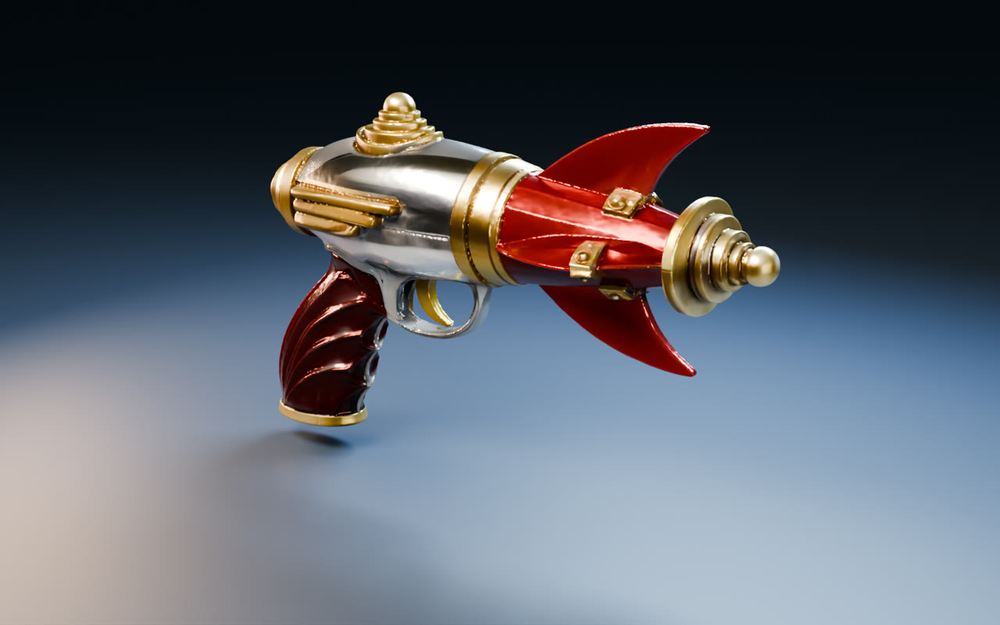

# Red Comet · From one image to Blender

Preview 32 turns the included Red Comet reference into a textured GLB. This example follows a real run from the Foundry wizard through MCP and into Blender. Red Comet is an original retro ray-gun design inspired by 1930s space serials.

- [Watch or download the 44-second walkthrough](https://github.com/mumblebox-gpt/mumblebox-foundry/releases/download/v0.1.0-preview.32/red-comet-walkthrough.mp4)
- [Watch or download the six-second Blender turntable](https://github.com/mumblebox-gpt/mumblebox-foundry/releases/download/v0.1.0-preview.32/red-comet-studio-turntable.mp4)
- [Download the original PNG reference](https://github.com/mumblebox-gpt/mumblebox-foundry/releases/download/v0.1.0-preview.32/red-comet-original.png)
- [Download the raw Foundry GLB](https://github.com/mumblebox-gpt/mumblebox-foundry/releases/download/v0.1.0-preview.32/red-comet.glb)
- [Verify the demo files](https://github.com/mumblebox-gpt/mumblebox-foundry/releases/download/v0.1.0-preview.32/red-comet-SHA256SUMS.txt) · [Read the production record](provenance.json)

## Reproduce it

1. Follow the [Pinokio install guide](../../PINOKIO.md). Start and open Foundry. In **Single Image or Text**, select **Use sample image**.
2. Advance to **Mesh and refinement**, open **First-use files**, and check disk space and any unknown requirements. For this tested run the required weights were already cached. The screen reported one unknown requirement handled by Hi3D.
3. Keep the default Pixal3D geometry and seed 42. The example used 1024 shape resolution, 1536 Hi3D refinement at 25 steps with CPU offload and seed 42, and standard TRELLIS.2 texturing with 4096 textures and seed 42. Select only **Detailed → GLB** for this result.
4. Click **Next** to build and refine the mesh. Review the preview and choose **Next** to finish. To do that last part through the [Foundry MCP](../../AGENT-SETUP.md), read `foundry_capabilities`, check `foundry_run_status` on the saved run ID, and call `foundry_start` with `operation: finish` and a request ID. Poll status and call `foundry_package` to obtain the ZIP. You can use the same visible Foundry workspace to see progress.
5. Download the ZIP, extract `Detailed/mesh.glb`, and import it with **File → Import → glTF 2.0** in Blender. Inspect the scale and geometry before using it in a project. The generated units are metres with uncalibrated scale.

The exact GLB has 816,292 triangles, 523,521 vertices, one UV layer and two embedded 4,096 × 4,096 texture images. This is a detailed starting asset. Choose a lower-poly output or retopologize for a game where the performance budget calls for it.

On the test Windows 11 machine with an RTX 4080 SUPER (16 GB VRAM, 64 GB installed RAM), cached preparation took under a second as recorded by stage events. Geometry took 28 seconds, refinement 8m 36s, texturing 1m 27s after the retry, and packaging 22 seconds. The demo cuts around the waits. A first download and other hardware can change these times.

## Walkthrough transcript

Both videos are silent. The walkthrough shows captured Foundry and Blender screens with written instructions. The turntable uses the same exported model in a Blender presentation.

| Time | What appears |
| --- | --- |
| 0:00–0:06 | The Single Image or Text wizard shows the red, brass and chrome ray-gun reference loaded from **Use sample image**. |
| 0:06–0:12 | The **First-use files** panel lists stages and model files. The selected output is Detailed GLB. |
| 0:12–0:18 | Foundry shows the initial untextured mesh while Hi3D refines it. The generation wait is cut. |
| 0:18–0:25 | The refined mesh is ready to inspect. The on-screen steps explain how an agent reads capabilities and starts **finish** using the same run ID. |
| 0:25–0:31 | The finished package screen offers **Download ZIP**. The ZIP contains the textured GLB, separate texture maps, a README and model notices. |
| 0:31–0:38 | The imported model is open in Blender. Check the geometry, scale and embedded maps. Blender adds the camera, lights, backdrop and a rotation. |
| 0:38–0:44 | The model completes one full turn under warm and cool softboxes. The light moves across the red fins, chrome body, brass trim and curved grip as the prop rotates. |

Blender 5.2.2 LTS rendered the turntable in Cycles. The separate downloadable GLB is the original Foundry export with its original mesh and texture bytes.

The input comes from [OpenAI image generation](https://openai.com/policies/terms-of-use/). Production used Pixal3D, Hi3D and TRELLIS.2 with dependencies listed in the exported package. See the [Foundry notices](../../../THIRD-PARTY.md) and [Hi3D](https://hi3d.ai/) for source credits and terms. Powered by Hi3D 1.0.
